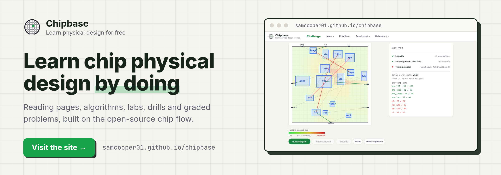

# Chipbase

<p align="center">
  <a href="https://samcooper01.github.io/chipbase/"></a>
</p>

Chipbase is a free site for learning chip physical design. It has reading pages on each stage of
the flow, pages on the algorithms behind them, interactive labs, drills, and problems graded in the
browser. It is live at [samcooper01.github.io/chipbase](https://samcooper01.github.io/chipbase/).

This repository is the whole site, and additions are welcome. This guide explains how to run the
site on your own machine, where each kind of content lives, and how to check your work before you
open a pull request.

## Two ways to contribute

- **Report or suggest, with no code.** Every drill card has a "flag this one" button, and the drills
  page has "Suggest a drill". Both open a prefilled issue on this repository. For a mistake on any
  other page, open an issue directly.
- **Add or fix content** with a pull request. The rest of this guide covers that.

Before writing something large, such as a new reading page, a new drill deck or a new lab engine,
open an issue describing it.

## Where help is most useful

- **Graded problems.** There are 15, covering floorplanning, placement, clock tree synthesis,
  timing and scripting. Logic synthesis, routing, physical verification and ECO (Engineering Change
  Order) have none yet.
- **Algorithm pages for synthesis and finishing.** Each stage has five, against about twenty for
  floorplanning, placement and routing.
- **A reading page on power delivery.** Power has ten labs and one algorithm page, on voltage drop
  across the power grid, but no reading page.
- **Corrections.** A wrong number, a broken explanation or a missing source is always worth an
  issue or a pull request.

## Run the site locally

You need Python 3.10 or newer.

```bash
git clone https://github.com/Samcooper01/chipbase
cd chipbase
./run.sh --reload     # serves http://127.0.0.1:8888; PORT=8890 ./run.sh --reload for another port
```

The first run creates `.venv/` and installs the requirements. With `--reload`, the server restarts
itself whenever a Python file changes. After editing a `.yaml` file, or anything under `app/static/`,
stop the server and start it again, or the browser may keep showing the old version.

## What you can add

There are six kinds of content. For each one, the fastest start is to copy an existing item of the
same kind and change it: the existing content is the most complete guide to the format.

### A graded problem

One folder per problem, in `problems/<id>/`:

```
problem.yaml       title, topic, difficulty, points, engine, and the checks that grade it
description.md     the lesson and the task, shown on the problem page
starter/           the files the learner edits, filled with placeholders
solution/          a reference solution
evaluate.js        turns a submission into numbers (metrics) for the checks
assets/            script problems only: the made-up design the script runs against
harness/           openroad problems only: grade.tcl and the design data it needs
```

Each problem uses one of four grading engines, set by `engine:` in `problem.yaml`:

- `quiz`: the learner submits a number, such as a slack worked out by hand.
- `sim`: `evaluate.js` reads the submitted files as text and computes metrics from a simple model
  of the trade-off being taught.
- `script`: the learner writes a Tcl (Tool Command Language) script. It runs in a real interpreter
  inside the browser, against a stand-in tool shell with a small made-up design. Grading looks at
  what the script did to the design and what it printed, so any correct script passes.
- `openroad`: graded by a real [OpenROAD](https://theopenroadproject.org) run, which cannot happen
  in a browser. The learner runs it on their own machine; `harness/grade.tcl` replaces
  `evaluate.js` and writes `metrics.json`.

The checks in `problem.yaml` compare metrics with limits (`between`, `<=`, `>=`, `~=`), and a
problem is solved when every check passes. A shortened `problem.yaml`:

```yaml
id: fp-core-size
title: "Size a core to hit target utilization"
topic: Floorplanning
difficulty: easy
points: 100
engine: sim
kind: files
editable:
  - path: floorplan.tcl
    language: tcl
checks:
  - id: util
    label: "Core utilization lands in the healthy 0.60-0.72 window"
    metric: utilization
    op: between
    min: 0.60
    max: 0.72
```

`evaluate.js` exports one function that reads the submission and returns its metrics, here
`{ metrics: { utilization: 0.66, ... }, notes: [...] }`. It receives a toolkit (`g.read`,
`g.parseTclSets`, `g.requireNumber`, `g.runStubbedTcl`, `g.gradeExactOutput`), described in
`app/static/grader/toolkit.js`. The new problem appears on the problems page under its `topic`
with no other edit. Before you finish, make sure the starter fails and the solution passes.

### A drill deck

Flash-card decks are files in `app/game_decks/`: `<id>.yaml` holds the cards and
`<id>_scope.md` records what the deck covers and where its answers were checked.
[`app/game_decks/README.md`](app/game_decks/README.md) describes the file format and every card
style. To put a new deck on the site, add an entry for it to `FLASH_DECKS` in
`app/games_content.py`; adding cards to an existing deck needs no other edit.

Every card needs three plausible wrong answers, a hint phrased as a question, and an explanation
with a source. The correct answer must not be the longest option, and quoted tool output must be
copied from a real file or run. The other drills keep their content in the same way:
`app/game_logs/` (log forensics), `app/game_metrics/` (over or under), `app/game_choices/` (what
happens if) and `app/game_images/` (spot the pathology).

### A glossary term

Terms are entries in [`app/glossary/glossary.yaml`](app/glossary/glossary.yaml), each with a
`term`, a `category` (one of the categories at the top of the file), a `definition` of one or two
sentences, and an `expansion` if the term is an acronym:

```yaml
  - term: Netlist
    category: flow
    definition: >-
      A list of cell instances and the nets that connect their pins. It
      describes what is connected to what, but not where anything is.
```

The "Appears in" links on the glossary page are found by searching the site, so you never write
them.

### A reading page

Reading pages are entries in `TOPICS` in `app/education_content/education.py`. Each has a `slug`
(its address, `/education/<slug>`), a `name`, the short `shelf`, `tagline` and `blurb` texts used
on index pages, `live: True` to publish it, and a Markdown `body`. Each `##` heading in the body
becomes an entry in the page's table of contents. Equations are written as
`<div class="eq">` followed by a `<ul class="eq-legend">` that defines every symbol; the existing
pages show the pattern. Most contributions here extend an existing page with a new section.

### An algorithm page

Algorithm pages are grouped by flow stage, one Python file per stage in `app/algo_content/`. A page
is an entry in that file's `ALGORITHMS` list, published at `/explore/algorithms/<stage>/<slug>`.
It carries a `name`, a `family` (one of the families defined in the file's `STAGE`), a `level`, the
`year` and `who` of its origin, a one-line `card`, a `summary`, a Markdown `body`, and `refs` that
link its sources. A new stage is a new file, with its name added to `_STAGE_MODULE_NAMES` in
`app/algo_content/__init__.py`.

### A lab

A lab is an interactive exercise in the browser, built from three parts:

- an **engine**, the JavaScript in `app/static/labs/<engine>.js` that draws the exercise and checks
  the learner's moves;
- a **spec**, a Python dictionary in `app/lab_content/*_specs.py` that sets up one exercise for
  that engine (the layout, the targets, the hint);
- a **prompt**, the Markdown task shown above it.

Register the lab in `LABS` in `app/lab_content/labs.py` with its `id`, `title`, `topic`,
`topic_slug`, `difficulty`, `engine`, `prompt` and `spec`. It is published at `/lab/<id>`. To list
it on the problems page, add an item with `"href": "/lab/<id>"` under its topic in `PLANNED_TYPES`
in `app/problems.py`. A new exercise for an existing engine needs only a spec and a prompt.

A new engine is a script that defines one global object with two functions: `mount(container,
spec)`, which builds the exercise inside the given element, and `evaluate(spec, state)`, which
grades the learner's work without touching the page, so it can be tested on its own. `maze.js` is a
short example. Give the engine its own branch in `app/templates/lab.html`, which loads the script
and calls `mount` with the spec.

## Writing style

Read [`STYLE.md`](STYLE.md) before writing. The rules that matter most:

- Write like a textbook: plain, precise, declarative sentences. No dramatic phrasing or filler.
- Expand every acronym in parentheses at every use, for example "CTS (Clock Tree Synthesis)".
- Do not use em dashes or en dashes as punctuation.
- Cite sources with links, and mark any claim about the internals of a commercial tool as inferred
  unless it is documented.

## Before you open a pull request

Run these from the repository root, after `./run.sh` has created `.venv/` once:

```bash
.venv/bin/python tests/games/validate_content.py   # the content rules, for drills and the glossary
node tests/grader/check_grader.mjs                 # the browser grader against 349 recorded scorecards
.venv/bin/python -m app.freeze                     # builds the whole site; fails on any broken link
```

The grader check needs [Node.js](https://nodejs.org) 22 or newer. If you changed a drill, also play
it end to end against a running server:

```bash
cd tests/games && npm install && cd ../..   # once
node tests/games/play_drills.js http://127.0.0.1:8888
```

The same checks run automatically on every pull request, and the result shows on the pull request
page. Once it is merged, the workflow in `.github/workflows/pages.yml` runs them again, builds the
site and publishes it, usually within a few minutes.

## How the site works

The site is static. The [FastAPI](https://fastapi.tiangolo.com) app in `app/` is the authoring
copy: `python -m app.freeze` renders every page through the app's own routes
and writes the result to `site/`, which GitHub Pages serves. The published site lives below
`/chipbase/`, so the freeze adds that prefix to every link the app writes from the root. Everything
that differs between visitors, such as grading, solved problems and drill progress, happens in the
visitor's browser. There are no accounts and no server.

Grading runs in a background worker in the browser, so a submission never leaves the visitor's
machine and the page stops a runaway script after 10 seconds. Scripts run there in Tcl (Tool
Command Language) 8.6, compiled to WebAssembly by `tools/tclwasm/build.sh`.

```
app/
  main.py               every route; each one freezes to a static file
  freeze.py             the static build
  config.py             the published address and the repository issues go to
  templates/            the page templates
  static/               scripts, styles and images
    grader/             the browser grader and the Tcl (Tool Command Language) runtime
    labs/               the lab engines
  education_content/    reading pages
  algo_content/         algorithm pages, one file per stage
  lab_content/          lab specs and prompts
  game_*/               drill content
  glossary/             the glossary
  challenge_content.py  the Competition 01 page
problems/               graded problems, one folder each
tests/                  the grader, page and drill tests
tools/tclwasm/          how the Tcl (Tool Command Language) runtime is built
```

The Competition 01 page describes the challenge in the
[harness repository](https://github.com/Samcooper01/systolic-array-ai-accelerator-harness). Its
rules, scoring and reference numbers must match that repository's `README.md` and `scoring.yaml`.
